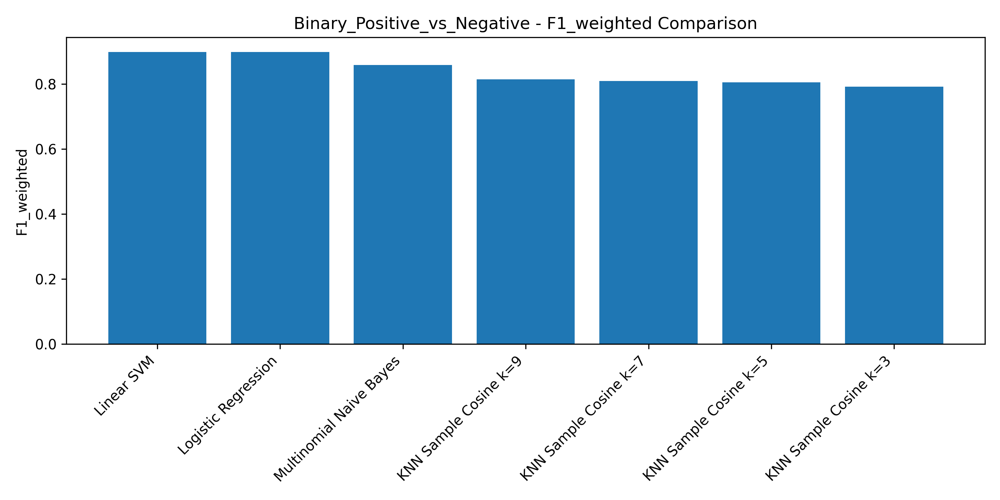

# YouTube Comment Sentiment Analysis: Comparative Machine Learning Study

**CSE 477: Data Mining · East West University · Spring 2026**

A comparative machine learning project investigating sentiment classification in YouTube comments. Building on a published K-Nearest Neighbors (KNN) study, the project evaluates alternative text classifiers, examines binary and three-class sentiment prediction, and analyzes the trade-offs between classification performance and computational efficiency.

## Overview

YouTube comments contain informal language, emojis, brief reactions, and context-dependent expressions that complicate automated sentiment analysis. The reference study by Lestandy and Patmanthara (2025) used K-Means-based labeling followed by KNN classification, but did not compare KNN with several established text-classification baselines.

This project extends that investigation by comparing **KNN, Multinomial Naive Bayes, Logistic Regression, and Linear Support Vector Machine (SVM)** using TF-IDF features. It also broadens the task beyond positive and negative sentiment by examining a neutral category, together with class-level errors, runtime, and cross-validation stability. The approach is a **comparative extension**, not an exact reproduction of the reference paper.

## Dataset and Approach

The experiments use the [`GBcomments.csv` dataset from Kaggle's *Trending YouTube Video Statistics and Comments* collection](https://www.kaggle.com/datasets/datasnaek/youtube?select=GBcomments.csv). The recorded notebook run loads **718,444 rows**; after excluding missing comment text, **718,416** records remain. Duplicate removal, spam/noise filtering, text cleaning, and minimum-length filtering produce **337,850 comments** for analysis.

Sentiment categories are assigned with **VADER** using compound scores from the original comment text: positive (≥ 0.05), negative (≤ −0.05), and neutral (between those thresholds). The resulting dataset includes **178,368 positive**, **69,882 negative**, and **89,600 neutral** comments. Only comment text is used as a predictive input; engagement metadata is not included in the classifiers.

The modeling pipeline combines:

- **Text preparation:** Duplicate and low-information comment filtering, emoji conversion, and text normalization.
- **Feature extraction:** TF-IDF unigrams and bigrams, up to **5,000 features**, with sentiment-relevant negation terms preserved.
- **Model evaluation:** Stratified **70:30** train–test splits, accuracy, precision, recall, weighted and macro F1-scores, confusion matrices, runtime, and error inspection.
- **Robustness analysis:** Five-fold stratified cross-validation for Logistic Regression and Linear SVM using a **100,000-comment binary sample**.

The binary experiment contains **248,250** positive and negative comments. KNN uses cosine distance with *k* = 3, 5, 7, and 9 on a **60,000-comment subset** because of its computational cost. The three-class experiment evaluates the other three classifiers on the full **337,850-comment** dataset.

## Results

| Model | Binary accuracy | Three-class accuracy |
| --- | ---: | ---: |
| **Linear SVM** | **89.62%** | **88.39%** |
| Logistic Regression | 89.54% | 87.26% |
| Multinomial Naive Bayes | 86.32% | 75.13% |
| KNN (*k* = 9; smaller sample) | 82.27% | Not evaluated |

**Linear SVM** achieved the highest held-out accuracy and weighted F1-score in both classification settings: **0.8985** for binary sentiment and **0.8842** for three-class sentiment. Logistic Regression performed closely behind and achieved a slightly higher mean binary cross-validation weighted F1-score (**0.8931 versus 0.8927** for Linear SVM). Multinomial Naive Bayes was the fastest of the full-dataset classifiers, while KNN required a smaller sample and is therefore not directly comparable under identical data volumes.

These outcomes describe how effectively the classifiers learn **VADER-generated pseudo-labels**, rather than agreement with independently human-annotated sentiment. Sarcasm, ambiguous wording, and contextual meaning remain limitations of the text-based analysis.

## Repository Contents

- [`CSE477.ipynb`](CSE477.ipynb) — Jupyter notebook containing preprocessing, sentiment labeling, modeling, evaluation, and saved visualizations.
- [`CSE477 project report.docx.pdf`](CSE477%20project%20report.docx.pdf) — Academic project report with the methodology and experimental analysis.
- [`outputs/`](outputs/) — Exported sentiment plots, confusion matrices, model comparison tables, and cross-validation results.

## Contributors

- Tahmina Ahmed
- Syed Ridwan Ahmed Fahim
- Md. Esrafil Rahman

## References

- [Datasnaek. *Trending YouTube Video Statistics and Comments*. Kaggle.](https://www.kaggle.com/datasets/datasnaek/youtube?select=GBcomments.csv)
- Lestandy, M., & Patmanthara, S. (2025). *Sentiment analysis of YouTube comments using the K-nearest neighbors (KNN) method from an axiological perspective.* **Energy: Jurnal Ilmiah Ilmu-Ilmu Teknik, 15**(2.5), 436–451. [https://doi.org/10.51747/energy.si2025.257](https://doi.org/10.51747/energy.si2025.257)
